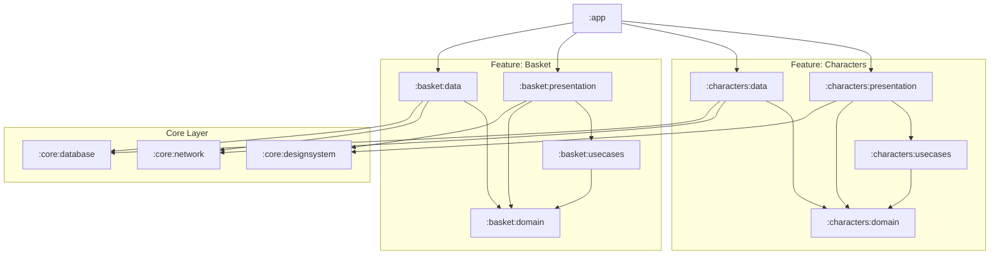

# Feature-Based Modularization Strategy (Vertical Slicing)

This document outlines the evolutionary path from the project's current Layer-Based architecture to a highly scalable Feature-Based architecture (Vertical Slicing using Feature-First grouping).

## Why Transition?
The initial **Layer-Based** architecture (`:app`, `:data`, `:domain`, `:usecases`) serves as a strict shield to enforce Clean Architecture principles. However, as the project grows, adding a single feature requires modifying all horizontal modules. This leads to two major bottlenecks:
1. **Massive Cache Invalidations**: Touching a single file in the monolithic `:data` module forces a recompilation of the entire `:app`.
2. **Merge Conflicts**: Multiple teams or agents working on different domains will constantly collide in the same horizontal modules.

## The Target Architecture (Feature-First Grouping)

In a mature, vertically sliced project, the architecture shifts from Horizontal Layers to **Feature-First Grouping**. 

Instead of organizing the project by layers at the root, you organize it by **Features**. Each feature gets its own physical directory (e.g., `/characters`), and inside that directory, you deploy the 4 Clean Architecture layers as independent Gradle sub-modules.

### The 4 Sub-Modules per Feature:
1. **`:characters:domain` (Pure Kotlin)**: Models and Repository Interfaces.
2. **`:characters:usecases` (Pure Kotlin)**: Business logic orchestration. Depends on `:characters:domain`.
3. **`:characters:data` (Android Library)**: Implementations, Room, Retrofit. Depends on `:characters:domain`.
4. **`:characters:presentation` (Android Library)**: Compose UI and ViewModels. Depends on `:characters:usecases` (and optionally `:characters:domain` for models).

### Build-Time Superpower (Compilation Avoidance)
Because of how Gradle dependency graphs work, this structure optimizes build times drastically. 
If a developer modifies a Room DAO inside `:characters:data`:
- `:characters:domain` and `:characters:usecases` **DO NOT** recompile (they are upstream dependencies).
- `:basket:data` and `:basket:domain` **DO NOT** recompile (they are in parallel isolated graphs).
- Only `:characters:data` and `:app` (the assembler) are recompiled.

---

## The Dependency Graph (Who sees who)

To ensure massive scalability and prevent Circular Dependencies, the dependency flow must strictly be a directed acyclic graph (DAG) pointing downwards.

> 🔍 **[View Live Dependency Graph](https://mermaid.live/edit#base64:eyJjb2RlIjogImdyYXBoIFREXG4gICAgQXBwW1wiOmFwcFwiXVxuXG4gICAgc3ViZ3JhcGggXCJGZWF0dXJlOiBDaGFyYWN0ZXJzXCJcbiAgICAgICAgQ2hhclByZXNbXCI6Y2hhcmFjdGVyczpwcmVzZW50YXRpb25cIl1cbiAgICAgICAgQ2hhclVzZVtcIjpjaGFyYWN0ZXJzOnVzZWNhc2VzXCJdXG4gICAgICAgIENoYXJEYXRhW1wiOmNoYXJhY3RlcnM6ZGF0YVwiXVxuICAgICAgICBDaGFyRG9tW1wiOmNoYXJhY3RlcnM6ZG9tYWluXCJdXG4gICAgZW5kXG5cbiAgICBzdWJncmFwaCBcIkZlYXR1cmU6IEJhc2tldFwiXG4gICAgICAgIEJhc2tldFByZXNbXCI6YmFza2V0OnByZXNlbnRhdGlvblwiXVxuICAgICAgICBCYXNrZXRVc2VbXCI6YmFza2V0OnVzZWNhc2VzXCJdXG4gICAgICAgIEJhc2tldERhdGFbXCI6YmFza2V0OmRhdGFcIl1cbiAgICAgICAgQmFza2V0RG9tW1wiOmJhc2tldDpkb21haW5cIl1cbiAgICBlbmRcblxuICAgIHN1YmdyYXBoIFwiQ29yZSBMYXllclwiXG4gICAgICAgIENvcmVEU1tcIjpjb3JlOmRlc2lnbnN5c3RlbVwiXVxuICAgICAgICBDb3JlTmV0W1wiOmNvcmU6bmV0d29ya1wiXVxuICAgICAgICBDb3JlREJbXCI6Y29yZTpkYXRhYmFzZVwiXVxuICAgIGVuZFxuXG4gICAgQXBwIC0tPiBDaGFyUHJlc1xuICAgIEFwcCAtLT4gQ2hhckRhdGFcbiAgICBBcHAgLS0-IEJhc2tldFByZXNcbiAgICBBcHAgLS0-IEJhc2tldERhdGFcblxuICAgIENoYXJQcmVzIC0tPiBDaGFyVXNlXG4gICAgQ2hhclByZXMgLS0-IENoYXJEb21cbiAgICBDaGFyVXNlIC0tPiBDaGFyRG9tXG4gICAgQ2hhclByZXMgLS0-IENvcmVEU1xuICAgIENoYXJEYXRhIC0tPiBDaGFyRG9tXG4gICAgQ2hhclRhdGEgLS0-IENvcmVOZXRcbiAgICBDaGFyRGF0YSAtLT4gQ29yZSREQlxuXG4gICAgQmFza2V0UHJlcyAtLT4gQmFza2V0VXNlXG4gICAgQmFza2V0UHJlcyAtLT4gQmFza2V0RG9tXG4gICAgQmFza2V0VXNlIC0tPiBCYXNrZXREb21cbiAgICBCYXNrZXRQcmVzIC0tPiBDb3JlRFNcbiAgICBCYXNrZXREYXRhIC0tPiBCYXNrZXREb21cbiAgICBCYXNrZXREYXRhIC0tPiBDb3JlTmV0XG4gICAgQmFza2V0RGF0YSAtLT4gQ29yZSREQlxuIiwgIm1lcm1haWQiOiAie1xuICB0aGVtZTogZGVmYXVsdFxufSIsICJhdXRvU3luYyI6IHRydWUsICJ1cGRhdGVEaWFncmFtIjogdHJ1ZX0)** (Click to open in Mermaid Live Editor)



**Graph Rules:**
1. **Arrows go DOWN**: A module can only see the modules the arrow points to.
2. **No Horizontal Arrows**: Notice there are NO arrows between `:characters:*` and `:basket:*`. Features are completely invisible to each other.
3. **App knows Everything**: The `:app` module sits at the very top. It sees the presentation layers (to wire Navigation) and the data layers (to wire DI/Repositories).
4. **Core knows Nothing**: Core modules sit at the very bottom. They do not depend on any feature modules.

---

## Module Roles: `:core` vs `:app` (The Integrator)

A critical mistake in modularization is putting "common" or shared code into the `:app` module. Doing so causes **Circular Dependencies** because `:app` must depend on features to assemble the final app, but features would need to depend on `:app` to access the common code.

### The `:core` Modules (The Shared Foundation)
Everything shared across multiple features belongs in `:core` modules at the bottom of the dependency graph.
*   **WHAT TO INCLUDE**: Design systems (`:core:designsystem` for custom buttons, typography, Compose themes), base network configurations (`:core:network` for Retrofit/Ktor clients), or generic UI utilities (formatters).
*   **WHAT TO AVOID**: Business logic, feature-specific models, or anything tied to a specific domain.

### The `:app` Module (The Motherboard)
The `:app` module sits at the very top of the dependency graph. It is an incredibly thin **Integrator** module. It does no real work itself; it just plugs the isolated pieces together.
*   **WHAT TO INCLUDE**: 
    1. Entry points (`MainActivity`, `Application` class).
    2. Global Dependency Injection wiring (e.g., `@HiltAndroidApp`, Koin `startKoin`).
    3. The root `NavHost` (orchestrating routing between completely isolated features).
    4. Third-party SDK initialization (Firebase, Crashlytics, Analytics).
*   **WHAT TO AVOID**: Common UI components, shared utilities, shared string resources, or any business logic.

---

## Feature-First Package Structure Example

Notice how the package names match the directory structure perfectly (`com.example.[feature].[layer]`):

```text
:core:network                        // Shared infrastructure
└── src/main/java/com/example/core/network

/characters                          // Feature Directory (Not a module itself)
├── :characters:domain               // Pure Kotlin
│   └── src/main/java/com/example/characters/domain
│       ├── model/Character.kt
│       └── repository/CharactersRepository.kt
│
├── :characters:usecases             // Pure Kotlin
│   └── src/main/java/com/example/characters/usecases
│       └── GetCharactersUseCase.kt
│
├── :characters:data                 // Android Library
│   └── src/main/java/com/example/characters/data
│       ├── network/CharactersApi.kt
│       └── repository/CharactersRepositoryImpl.kt // Depends on :core:network & :characters:domain
│
└── :characters:presentation         // Android Library
    └── src/main/java/com/example/characters/presentation
        ├── CharactersViewModel.kt   // Depends on :characters:usecases
        └── CharactersScreen.kt      

:app                                 // Android App (Integrator)
└── src/main/java/com/example/app
    ├── navigation/AppNavHost.kt     // Glues :characters:presentation and others together
    └── MainActivity.kt
```

## Advanced Implementation Patterns

### 1. Inter-Feature Communication
If `:basket` needs models from `:characters`, they CANNOT depend on each other horizontally.
*   **Solution**: Extract the shared models into a common underlying `:core:model:characters` or similar module. Communication flows downwards, never sideways.

### 2. Decoupled Navigation
Features must remain oblivious to the existence of other features.
*   **Solution**: Expose the UI via extension functions on `NavGraphBuilder` using callback lambdas for navigation events: `fun NavGraphBuilder.charactersScreen(onCharacterClick: (String) -> Unit)`.
*   The `:app` module acts as the integrator, wiring these callbacks inside the main `NavHost`.

## Golden Rules
1.  **No Feature-to-Feature Dependencies**: A feature's sub-module (e.g., `:characters:presentation`) must never include another feature's sub-module (e.g., `:basket:presentation`).
2.  **App as Integrator**: The `:app` module must remain thin, responsible only for Dependency Injection wiring and the Navigation Graph.
