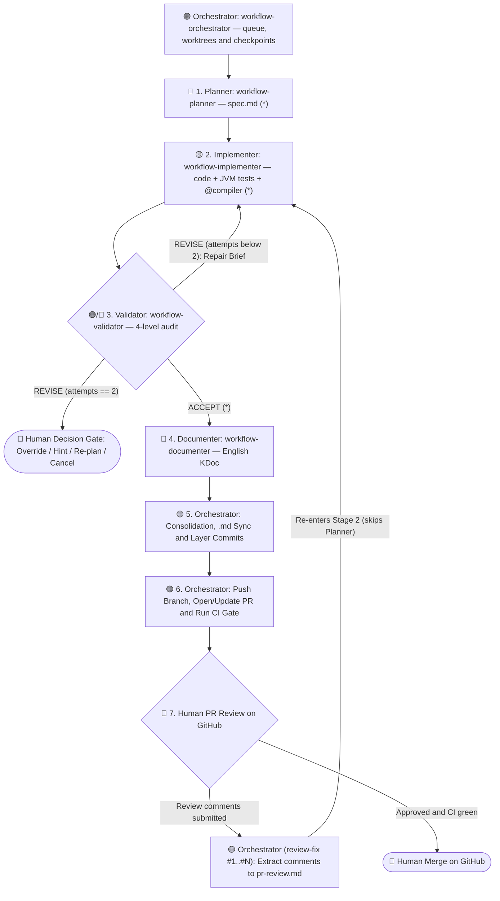

# 🚀 Android AI Workflow Foundation

A unified, provider-agnostic multi-agent engineering framework for Android. It combines **Clean Architecture & Compose guardrails**, a **persistent project harness** (`AGENTS.md`, `PROGRESS.md`, `CONSTRAINTS.md`, `feature_list.json`), and **isolated `git worktree` subagents** (`workflow-orchestrator`, `workflow-planner`, `workflow-implementer`, `workflow-validator`, `workflow-documenter`).

> **Philosophy — Human as Supervisor:** The goal is not blind automation. The developer remains the architect and final decision-maker—approving technical contracts, setting checkpoints where risk is high, and reviewing/merging Pull Requests on GitHub.

---

## ⚡ Quick Start

### Prerequisites
* **Node.js** (required for `npx skills` CLI and automated safety hooks)
* **JDK 17 or 21** (for Gradle builds and unit tests)
* **Git 2.30+** (for `git worktree` isolation)

### 1. Install the Foundation Skills
Run from the root of your Android repository:
```bash
npx skills add albertmartorell1975/android-ai-workflow-foundation -y
```

### 2. Initialize Your Project (`workflow-initializer`)
Open your AI IDE and prompt:
```text
Activate workflow-initializer
```
The initializer inspects your module topology (*Layer-Based* vs. *Feature-First*), asks for your **target AI provider** and any **optional catalog plugins**, and generates `AGENTS.md`, provider-native subagents, safety hooks, and AI context exclusions. It also checks **GitHub CLI (`gh`)** status and offers to install it if missing (once installed, run `gh auth login`)—without an authenticated `gh` CLI, the orchestrator cannot automatically open Pull Requests, trigger the CI quality gate, or fetch comments for `review-fix`.

### 3. Set Up Discovery & Project Harness
* **New product / MVP:** Run `@build-brief` for guided discovery (`CONTEXT.md`, `docs/build-brief.md`, `docs/domain-model.md`, `DESIGN.md`), then run `@harness-starter`.
* **Existing Android codebase:** Run `@harness-starter` directly. In both cases, it generates `PROGRESS.md`, `CONSTRAINTS.md`, `feature_list.json`, `docs/features/<feature-id>/` folders, and the CI quality gate (`.github/workflows/gate.yml`) in your Android repository.
* **Start building:** Invoke `@workflow-orchestrator` with a specific feature request (Standalone Mode) or `"continue"` to process `feature_list.json` / pending PR reviews.

### Updating an Existing Project
When the Foundation releases new or updated skills, propagate them to a consuming Android project in two steps:
1. **Update `.agents/skills/`:** Run `npx skills update` (or `npx skills add albertmartorell1975/android-ai-workflow-foundation -y`) from your project root.
2. **Re-sync generated provider files (when needed):** Because `npx skills` only updates `.agents/skills/`, if the update also changed subagent definitions, safety hooks, or context exclusions, ask your AI IDE to refresh those generated files from the updated `workflow-initializer` / `agent-safety-hooks` / `ai-context-exclusion` templates while preserving your existing `AGENTS.md`, `PROGRESS.md`, `CONSTRAINTS.md`, and `feature_list.json`.

---

## 🛠 Multi-Provider Support, Safety Hooks & Context Exclusion

`workflow-initializer` adapts the exact same Foundation workflow to your chosen AI environment:

| AI Provider | Subagents | Safety Hooks (`agent-safety-hooks`) | Context Exclusion (`ai-context-exclusion`) |
| :--- | :--- | :--- | :--- |
| **Gemini / Antigravity** | `.agents/agents/workflow-*.md` | `.agents/hooks.json` + `.agents/hooks/*.js` | `.aiexclude` |
| **Claude Code** | `.claude/agents/workflow-*.md` | `.claude/settings.json` + `.claude/hooks/*.js` | `.claude/settings.json` |
| **Cursor** | `.cursor/agents/workflow-*.md` | `.cursor/hooks.json` + `.cursor/hooks/*.js` | `.cursorignore` |

* **🛡 Automated Safety Hooks (installed out of the box):**
  * `block-rm-rf.js`: Blocks destructive shell commands (`rm -rf`, `git reset --hard`, `git clean -f`, force pushes, and autonomous `gh pr merge`).
  * `check-agents-size.js`: Blocks `git commit` if `AGENTS.md` exceeds **120 lines or 6 KB** to prevent context rot.
  * *Custom hooks:* Project-specific hooks can be authored on demand using `@hook-creator` from the optional catalog.
* **🔒 Context Exclusion:** Automatically keeps `local.properties`, `.worktrees/`, `.gradle/`, and `build/` out of the AI context, and translates rules if you switch providers later.

---

## 🏗 Feature Delivery Pipeline

Every feature flows from specification to validated code, KDoc comments, atomic commits, and a GitHub Pull Request inside isolated `git worktree` environments:



*(Where `(*)` denotes an optional human checkpoint via `require_review_after` or user prompt.)*

### Specialized Agent Roles

| Role | Core Skill | Execution Scope | Responsibilities |
| :--- | :--- | :--- | :--- |
| 🟣 **Orchestrator** | `workflow-orchestrator` | Feature branch (`feature/<id>`) | Coordinates queue & `depends_on` PR gates, hydrates worktrees/APKs, enforces checkpoints & repair loops (`MAX_REPAIR_ATTEMPTS = 2`), updates harness & project `.md` docs, creates atomic commits (`@git-governance`), and opens PRs. |
| 🔵 **Planner** | `workflow-planner` | Clean context (`docs/features/<id>/`) | Asks up to 3 blocking questions and writes `spec.md` (`Given/When/Then` scenarios, layer breakdown, Clean Architecture checklist). Never writes app code. |
| 🟡 **Implementer** | `workflow-implementer` | `.worktrees/impl-<id>` | Implements Clean Architecture layers (`Domain -> Data -> UseCase -> UI`), converts `ui/resources/` assets to `.webp`, writes JVM tests, and runs `@compiler` checks. |
| 🟢/🔴 **Validator** | `workflow-validator` | `.worktrees/val-<id>` | Strictly read-only adversarial auditor across **4 levels** (Spec, Security/Scope, `@compiler`/Tests + 13 SOLID triggers, and optional `@android-cli` emulator runtime). Emits `accept`, `revise` + Repair Brief, or `block`. |
| 🔷 **Documenter** | `workflow-documenter` | `.worktrees/doc-<id>` | Runs only after `accept`. Adds English KDoc comments to public project classes without modifying code logic. |

---

## 🔄 Execution Modes & Human-in-the-Loop Governance

### Execution Modes
1. **Mode A — Standalone Feature:** Request any feature directly (*"Implement User Profile screen"*). The orchestrator audits open PRs first, registers/selects the feature in `feature_list.json`, enforces any `depends_on` PR gates, and runs the full pipeline through automatic PR creation.
2. **Mode B — Backlog Queue (`feature_list.json`):** Prioritizes pending PR reviews (`review-fix`), resumes `in_progress`/`passing` work, and picks the next `not_started` feature whose `depends_on` are all `accepted`, PR-clean, and merged into `develop`.
3. **Mode C — Post-PR Review Loop (`review-fix`):** Leave inline or general comments on an open PR on GitHub (`Comment` -> `Submit review`) and tell `@workflow-orchestrator` to *continue*. It automatically extracts new comments via `gh api`, logs `## PR Review Round #N` in `pr-review.md`, runs `Implementer -> Validator -> Documenter` (never the Planner, keeping the existing `spec.md` contract intact), and pushes only the round delta. If a PR is closed without merging (`CLOSED`), the orchestrator rolls back `feature/<id>` cleanly to `not_started`.

*(Autonomous `gh pr merge` is strictly prohibited at all times—merging is 100% human-owned. See [PR Review Loop](.agents/skills/workflow-orchestrator/references/pr-review-loop.md) for full details.)*

### Human-in-the-Loop Checkpoints
* **Configurable Checkpoints (`require_review_after`):** Place pause gates in `feature_list.json` after `"planner"`, `"implementer"`, `"validator"`, or an array like `["planner", "validator"]`. When paused, choose **`[Approve & Proceed]`**, **`[Human Guidance / Hint]`**, **`[Manual Worktree Edits]`**, or **`[Abort / Defer]`**.
* **Recommended High-Leverage Pattern:** Pause after **Planner** (`"require_review_after": "planner"`) to validate `spec.md` before any code is written, let `Implementer ⇄ Validator -> Documenter -> PR` run autonomously, and review the code directly in the **GitHub Pull Request**.
* **Reactive Decision Gate (`needs_human_review`):** If Implementer and Validator do not reach `accept` within `MAX_REPAIR_ATTEMPTS = 2`, looping stops, the worktree stays intact, and the developer resolves it via **Override**, **Hint**, **Re-plan**, or **Cancel**.

---

## 🧩 Android Stack, Guardrails & Pragmatic Testing

The Foundation ships **37 active skills** under `.agents/skills/` and **25 optional catalog plugins** under `.agents/catalog/` (see the [Canonical Skills Index](.agents/skills/README.md)):

* **Supported Module Topologies:**
  * **Layer-Based** (small/medium apps): `:domain`, `:usecases`, `:data`, `:app`.
  * **Feature-First** (scalable/multi-team): `:<feature>:{domain,usecases,data,presentation}`, `:core:*`, `:app`.
* **Opinionated Engineering Stack:** Kotlin, Clean Architecture & SOLID, MVVM with Hybrid UI State, Repository SSOT with typed `DomainError`, **Hilt**, **Room**, **Firebase** (Auth, Remote Config), and **Jetpack Compose** (Navigation 3, adaptive layouts, edge-to-edge, state hoisting, side effects).
* **Pragmatic Testing Strategy:**
  * **Closed, high-value test budget (0–6 `@Test` per feature):** Pure JVM unit tests (JUnit + Manual Fakes + `MainDispatcherRule` + Turbine) planned upfront in `spec.md` only for layers with real branching, calculations, error mapping, multi-source orchestration, or ViewModel state transitions (**0 tests** by default on boilerplate or 1:1 pass-through layers).
  * **Zero bloat:** No Robolectric screen tests, no mocking frameworks (`MockK`/`Mockito`) over domain interfaces, and no trivial tests—every test is audited for falsifiability and non-trivial value.
  * **Black-box UI journeys:** End-to-end flows validated on an active emulator/device (and skipped cleanly when no device is attached).
* **Optional Catalog Plugins (on demand):** CameraX, Wear Compose M3, AppFunctions, R8 Analyzer, Perfetto Trace/SQL, Compose stability/recomposition diagnostics, Play Billing/Policy tools, and custom skill/hook authoring.

---

## 📁 Project Harness, Feature Directory & Lifecycle

The Foundation separates project-wide harness tracking at the repository root from per-feature contracts, visual references, and review history:

```text
your-android-project/
├── AGENTS.md                           # Routing map & project guardrails (max 120 lines / 6 KB)
├── PROGRESS.md                         # Current verified state & session log
├── CONSTRAINTS.md                      # Durable MUST / MUST NOT architectural rules
├── feature_list.json                   # Backlog queue, depends_on, checkpoints & status
├── .github/workflows/gate.yml          # CI quality gate triggered on PRs
└── docs/features/<feature-id>/
    ├── spec.md                         # Unified contract (Given/When/Then + layers + test plan)
    ├── ui/
    │   ├── screens/                    # Reference mockups (PNG/HTML — never converted to drawables)
    │   └── resources/                  # Raw assets (PNG/JPEG -> converted to res/drawable/ic_*.webp)
    └── validator/
        ├── validation-report.md        # 4-level report & Adversarial Attempts Log
        └── pr-review.md                # Human PR review feedback (Round #1..#N)
```

**Feature lifecycle in `feature_list.json`:**
* **Normal flow:** `not_started` → `in_progress` → `passing` *(Implementer)* → `accepted` *(Validator + Documenter + Orchestrator)*
* **Exceptions & PR transitions:** `needs_human_review` *(escalated after `MAX_REPAIR_ATTEMPTS = 2`)* · `blocked` *(explicit blocker or Validator `block` verdict)* · a `review-fix` round temporarily sets status back to `in_progress` until `accepted`, while a PR closed without merging rolls back to `not_started`.

---

## 📚 Detailed Documentation & Contributing

* **[Architecture & Engine Overview](docs/overview.md)** — Modular layers, worktree pipeline internals, and full testing matrix.
* **[Canonical Skills Index](.agents/skills/README.md)** — Complete catalog of active Foundation skills and optional catalog plugins.
* **[Git Worktree Lifecycle](.agents/skills/workflow-orchestrator/references/worktree-lifecycle.md)** — Shell workflows for hydration, APK transfer, and consolidation.
* **[Operational Modes](.agents/skills/workflow-orchestrator/references/operational-modes.md)** & **[PR Review Loop](.agents/skills/workflow-orchestrator/references/pr-review-loop.md)** — Preconditions, report schema, and `depends_on` PR gating rules.
* **Evolving & Maintaining the Foundation:** Use `@foundation-evolve` to promote refined skills from a consuming Android project back to this repository. Contributors modifying this repo directly must follow [AGENTS.md](AGENTS.md).

---

## 🙏 Acknowledgments & Credits

* **Foundation Methodology & Clean Architecture Guardrails:** Albert Martorell Garcia.
* **Harness & Multi-Agent Spec/Validator Methodology:** Originally created by **Antonio Leiva / Nino Ruano** for the AI Expert course and unified into this Foundation with permission.
* **External Expert Patterns:** Curated Kotlin and Compose skills by **Chris Banes** and official Android/Firebase guidelines.
