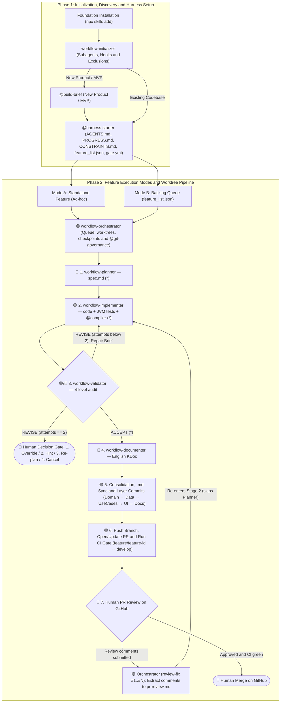

# Architecture Overview

The **Android AI Workflow Foundation** is a unified, provider-agnostic multi-agent framework for Android development. It combines Clean Architecture engineering guardrails, persistent project harness state (`feature_list.json`, `PROGRESS.md`, `CONSTRAINTS.md`), and isolated **`git worktree`** subagents under human supervision.

The Foundation structures development across three modular layers:

1. **Project Initialization & Harness Setup** (`workflow-initializer`, `build-brief`, `harness-starter`)
2. **Unified Multi-Agent Feature Pipeline** (`workflow-orchestrator`, `workflow-planner`, `workflow-implementer`, `workflow-validator`, `workflow-documenter`)
3. **Shared Engineering Guardrails & Android Expertise** (`compiler`, `git-governance`, Clean Architecture, Hilt, Room, Firebase, Kotlin, and Jetpack Compose skills)

---

### High-Level Architecture

*(Where `(*)` denotes an optional human checkpoint via `require_review_after` or user prompt.)*

---

## Layer 1: Initialization, Discovery & Harness

### 1. `workflow-initializer`
Bootstraps the project environment and adapts customizations to the selected AI Provider (**Gemini / Antigravity**, **Claude Code**, or **Cursor**):
* Performs Stack Auto-Inspection (Project Name, Module Topology) and checks **GitHub CLI (`gh`)** availability (offering to install it if missing so automated PRs and `review-fix` work), then executes a **Hard Stopping Gate** to prompt the developer for their target AI Provider and Optional Catalog Plugins before generating any project files. Standards (MVVM, Hilt, Room, Firebase) are active by default.
* Materializes `AGENTS.md` and adds `.worktrees/` to `.gitignore`.
* Configures provider-native **AI Context Exclusion** (`ai-context-exclusion`: `.aiexclude`, `.claude/settings.json` `permissions.deny`, or `.cursorignore`), automatically excluding `local.properties`, `.worktrees/`, `.gradle/`, and build outputs from the AI context.
* Materializes provider-specific **Subagent Definitions** (`workflow-planner`, `workflow-implementer`, `workflow-validator`, `workflow-documenter` under `.agents/agents/`, `.claude/agents/`, or `.cursor/agents/`) using **`SUBAGENT_SKILLS.json`** and **Role-Tuned Model Selection** (`inherit`/`opus` for Planner and Validator; `inherit`/`sonnet`/`fast` for Implementer; `flash`/`haiku`/`fast` for Documenter).

#### 🛡 Automated AI Safety Hooks (`agent-safety-hooks`)
During project initialization, the Foundation installs provider-native lifecycle safety hooks (`.agents/hooks.json`, `.claude/settings.json`, or `.cursor/hooks.json`):
* **`block-rm-rf.js` (Destructive Command Guard)**: Intercepts shell commands before execution and strictly blocks catastrophic patterns such as `rm -rf`, `rmdir /s /q`, `git clean -f`, `git reset --hard`, autonomous `gh pr merge` (ensuring PR merges are strictly human), and destructive force pushes.
* **`check-agents-size.js` (`AGENTS.md` Size Guard)**: Blocks `git commit` if `AGENTS.md` exceeds 120 lines or 6 KB to prevent context window degradation.
* **Custom Hooks (`@hook-creator`)**: Additional project-specific hooks can be authored on demand for any of the three providers.

### 2. `build-brief` & `harness-starter`
* **`build-brief`**: Conducts a structured one-question-at-a-time discovery interview for new products or major modules, producing `CONTEXT.md`, `docs/build-brief.md`, `docs/domain-model.md`, and `DESIGN.md`.
* **`harness-starter`**: Derives `AGENTS.md`, `PROGRESS.md`, `CONSTRAINTS.md`, `feature_list.json`, and `.github/workflows/gate.yml` (plus `docs/features/<feature-id>/` directories), either from `build-brief` discovery docs or directly from an existing Android codebase.

---

## Supported Modular Topologies (`module-architecture-governance`)

The Foundation supports two Clean Architecture module topologies depending on app scale:

1. **Layer-Based Modular Topology (Small to Medium Apps)**:
   * `:domain` — Pure Kotlin business entities, Repository interfaces & `DomainError` models.
   * `:usecases` — Pure Kotlin single-responsibility interactors.
   * `:data` — Repository implementations, Room DAOs, DataSources, Network DTO mappers.
   * `:app` — Jetpack Compose UI, ViewModels, Navigation, and Dependency Injection graph.

2. **Feature-First Modular Topology (Scalable & Multi-Team Apps)**:
   * `:<feature>:domain` — Feature-scoped business entities, repository interfaces & `DomainError` models.
   * `:<feature>:usecases` — Feature-specific interactors.
   * `:<feature>:data` — Feature local/remote data sources & repository implementations.
   * `:<feature>:presentation` — Feature Jetpack Compose UI screens & ViewModels.
   * `:core:database`, `:core:network`, `:core:designsystem`, `:core:common` — Shared foundations.
   * `:app` — Thin application shell, global NavHost & root DI container.

---

## Layer 2: Unified Multi-Agent Feature Pipeline

Whether a developer requests a **Standalone Feature (Mode A)** or processes a **Backlog Queue from `feature_list.json` (Mode B)**, every feature executes through five specialized roles:

### 1. 🟣 Orchestrator (`workflow-orchestrator`)
* Reads `feature_list.json` and `PROGRESS.md` (creating or appending the feature entry automatically in Standalone Mode).
* **Shared Pre-flight PR Audit (Mode A & Mode B)**: Before any work, synchronizes `develop`, prunes merged branches, rolls back cancelled PRs (`CLOSED` without merge -> deletes local and remote `feature/<id>` branches so the repo returns to the exact pre-feature `not_started` state and asks whether to defer `<id>` to a future session or retry with new guidance), and inspects open PRs via `gh api` to detect unresolved review comments (prioritizing `review-fix`) and to enforce the **`depends_on` PR-clean & merged gate** (a feature never starts on top of a dependency whose PR is still under review or unmerged).
* Coordinates worktrees, hydrates build properties (`local.properties`, `.env`, `keystore.properties`, `app/google-services.json`), transfers compiled APK artifacts to the Validator worktree, pre-installs them on active emulators, and persists `docs/features/<feature-id>/validator/validation-report.md` from the read-only Validator's output.
* Manages bounded repair cycles (`MAX_REPAIR_ATTEMPTS = 2`) with an actionable Human Decision Gate (`needs_human_review`).
* **Human-in-the-Loop Supervision**:
  - **Flexibility Across Any Stage**: Every feature is different; checkpoints can be configured at any stage in `feature_list.json` (`require_review_after: "planner" | "implementer" | "validator" | ["planner", "validator"]`) or requested dynamically via prompt.
  - **Recommended High-Leverage Pattern**: Supervising after **Planner** (`"require_review_after": "planner"`) to validate `spec.md` before coding, letting the central loop (`Implementer ⇄ Validator -> Documenter -> PR`) run autonomously, and performing thorough code review on the resulting **GitHub Pull Request** (using the `review-fix` loop when adjustments are needed).
* Consolidates the final worktree after KDoc documentation completes, runs `./gradlew prepareKotlinBuildScriptModel --build-cache` if build scripts changed, updates harness and durable Markdown files (`spec.md`, `PROGRESS.md`, `feature_list.json`, and when needed `ARCHITECTURE.md`, `CONSTRAINTS.md`, `README.md`), creates atomic Conventional Commits (`Domain -> Data -> UseCases -> UI -> Docs`) via `@git-governance`, automatically pushes the branch and opens the Pull Request, and returns the root workspace to `develop`.

### 2. 🔵 Planner (`workflow-planner`)
* Spawns in a clean subagent context restricted to specification files, never modifying executable application code.
* Inspects the repository and clarifies up to 3 blocking technical questions with the user.
* Authors the unified feature contract at **`docs/features/<feature-id>/spec.md`** (`Given / When / Then` acceptance scenarios, Android layer breakdown, Clean Architecture checklist, and a closed 0–6 pure JVM test plan specifying `0 tests` for boilerplate or pass-through layers).

### 3. 🟡 Implementer (`workflow-implementer`)
* Runs in an isolated `git worktree` (`.worktrees/impl-<feature-id>`) hydrated with local Android properties.
* Implements Clean Architecture layers (`Domain -> Data -> UseCase -> UI`) strictly enforcing the **[Clean Architecture & SOLID Implementation Rules](../.agents/skills/workflow-implementer/references/clean-architecture-solid-rules.md)**, converts graphic assets in `ui/resources/` to `.webp`, writes only the pure JVM tests defined in `spec.md`'s closed 0–6 test plan, and runs the `@compiler` suite (`assembleDebug`, `lintDebug`, `testDebugUnitTest`), recording passing evidence.

### 4. 🟢/🔴 Validator (`workflow-validator`)
* Runs in an isolated `git worktree` (`.worktrees/val-<feature-id>`) with an **adversarial red-team mindset** as a **strictly read-only evaluator for repository files**.
* Evaluates **4 validation levels**:
  1. **Spec Contract & Acceptance Scenarios**: Verifies all `Given/When/Then` scenarios, checklist `[x]` fidelity, and UI states (`Loading`, `Error`, `Empty`, `Success`).
  2. **Security & Scope Discipline Audit**: Audits `android-intent-security` and strict `WIP=1` scope adherence (`CONSTRAINTS.md`).
  3. **Compiler Evidence, Pragmatic Test Quality & 18 Architecture/SOLID & Process Death Triggers**: Audits pure JVM unit tests (`testing-setup`) via the 3-filter trivial-test audit and per-test falsifiability table, verifies `@compiler` evidence (incl. uncached `--rerun-tasks` & Lint XML inspection), and enforces the **[18 Mandatory Architecture, SOLID & Senior Code-Review REVISE Triggers](../.agents/skills/workflow-validator/references/architecture-solid-audit.md)** (including Trigger #18 Process Death & Single-Activity State Restoration) plus an **Adversarial Attempts Log** and **Non-Blocking Code Review Observations**.
  4. **Runtime, Activity Recreation & Process Death Verification (`@android-cli`)**: When `spec.md` declares `UI Involved: yes` and an emulator/device is active, executes Acceptance Scenarios as black-box `@android-cli` journeys against the pre-installed application or hydrated APK from `app/build/outputs/apk/`, plus Activity recreation (`always_finish_activities 1 -> 0`) and LMK process-death (`KEYCODE_HOME` -> `am kill` -> Recents restore) probes on stateful UI features (or records `SKIPPED (headless)` when `UI Involved: no` or no device is active).
* Emits Verdict (`accept`, `revise`, or `block`) and an executable `Implementation Repair Brief` directly to the Orchestrator without modifying repository files.

### 5. 🔷 Documenter (`workflow-documenter`)
* Runs in an isolated `git worktree` (`.worktrees/doc-<feature-id>`) **only after `workflow-validator` returns `accept`**.
* Strictly documents public classes across all layers with English KDoc comments without altering executable code or modifying Markdown documentation files.

---

### 6. 🚀 Automatic GitHub PR Delivery & CI Gate (Stage 6)
* Immediately after Stage 5 consolidates atomic layer-specific commits via `@git-governance` and marks the feature `accepted`, the Orchestrator **automatically**:
  1. Pushes `feature/<feature-id>` to `origin` (`BypassSandbox: true`).
  2. Opens a structured Pull Request targeting `develop` via GitHub CLI (`gh pr create`) with pre-filled validation evidence (or via standalone `publish` mode if deferred).
  3. Triggers **`.github/workflows/gate.yml`** on GitHub Actions to execute non-interactive `./gradlew testDebugUnitTest lintDebug`.
* **Never Merge**: Autonomous merging (`gh pr merge`) is strictly prohibited—merging remains 100% human-owned.

---

### 7. 🔄 Post-PR Code Review & Feedback Loop (`review-fix` Multi-Round)
When the developer conducts code review on an open Pull Request (across 1 or N review rounds) and requests code quality, Clean Architecture, or SOLID improvements:
1. The developer reviews the PR in the GitHub UI (inline diff comments + **`Comment` -> `Submit review`**; *Request changes* is disabled on self-authored PRs). On the next invocation (*"continue"*, *"review-fix"*, or a new feature request), `@workflow-orchestrator` automatically inspects open PRs via `gh pr list` and `gh api` (`pulls/{pr}/reviews`, `pulls/{pr}/comments`, `issues/{pr}/comments`, plus GraphQL `reviewThreads` to skip threads already marked `isResolved: true`) and extracts every unresolved review submission and comment newer than the latest commit on `feature/<feature-id>` (or accepts feedback directly from the prompt). No GitHub Action or background watcher is required.
2. The orchestrator logs `## PR Review Round #N` (`PR Review Repair Brief`) in `docs/features/<feature-id>/validator/pr-review.md` on `feature/<feature-id>`.
3. Rehydrates isolated worktrees starting from the latest tip of `feature/<feature-id>`, and runs `Implementer -> Validator (auditing round delta & full diff with hydrated APK + emulator pre-install) -> Documenter`. The Planner is never re-run during code review: comments must fit the existing `spec.md`, and any contract change is escalated to the developer as a new feature or explicit re-plan.
4. Consolidates only the verified Round `#N` delta via atomic layer commits, pushes cleanly to `origin feature/<feature-id>` (`BypassSandbox: true`), and automatically updates the existing PR and re-triggers `.github/workflows/gate.yml` without touching the root workspace.
5. **Transitive `depends_on` PR Gate**: Any subsequent feature in `feature_list.json` that depends (directly or transitively via `depends_on`) on a feature with pending PR review comments or an unmerged open PR is strictly blocked/skipped during queue selection; only independent features with clean, merged dependencies may run in the meantime.

---

## Pragmatic Testing Strategy & Tooling Governance

The Foundation enforces a **pragmatic, high-value testing strategy** (`@testing-setup`) designed to prevent test bloat, brittle suites, and "Watermelon tests".

### Tooling Matrix by Testing Layer

| Testing Scope | Approved Tooling | Excluded / Forbidden Tooling | Core Rationale & Decisive Advantages |
| :--- | :--- | :--- | :--- |
| **Domain & Math Logic** (`:domain`) | **JUnit 4/5** + Kotlin assertions | Instrumented tests, Mocking libraries | Pure JVM execution in milliseconds without Android framework dependencies. |
| **Data & Serialization** (`:data`) | **JUnit 4/5** + **Manual Fakes** | MockK, Mockito, Real network/DB calls | Zero reflection overhead. Deterministic in-memory Fakes (`Fake*Repository`, `Fake*DataSource`). |
| **UseCase Orchestration** (`:usecases`) | **JUnit 4/5** + **Manual Fakes** | MockK, Mockito | Evaluates multi-source fallback and error translation. 1:1 pass-through UseCases have no tests. |
| **Presentation & ViewModels** (`:presentation` / `:app`) | **JUnit** + `MainDispatcherRule` + **Turbine** | **Robolectric**, `composeTestRule`, Espresso | Pure JVM reactive testing. Forbidding Robolectric screen tests eliminates slow shadow-class loading and brittle text matching. |
| **Visual Screen Correctness** | **Stateless `@Preview`** + `@compiler` | Paparazzi, Committed golden PNGs | Lightweight visual inspection via `@Preview` without bloating git storage with screen images. |
| **Design System Components** (`:design-system`) | **Roborazzi** (on JVM) + isolated widget `composeTestRule` | Paparazzi, `com.android.compose.screenshot` | Captures existing `@Preview` composables on the JVM; `composeTestRule` is allowed exclusively for isolated widget interaction states (`hover`/`focus`/`press`) inside `:design-system`. |
| **Real Flows & E2E Journeys** | **`@android-cli`** (Black-Box on emulator/device) | Espresso, `createAndroidComposeRule`, Maestro in repo | Acceptance Scenarios verified as black-box journeys on active devices (`android run`, `android layout --diff`, `android screen capture`). Skips cleanly (`SKIPPED (headless)`) in CI when no emulator is present. |

### Core Testing Invariants
1. **Pure JVM Presentation Testing**: Presentation tests are strictly limited to ViewModels and complex UI mappers. No functional Robolectric tests of screens or navigation are permitted (only `:design-system` isolated widgets allow `composeTestRule` and Roborazzi).
2. **Manual Fakes First**: Hand-crafted in-memory fakes are used for all domain interfaces.
3. **Closed Test Plan & Strict Budget**: Implement only the `*Test.kt` files planned in `spec.md` (1 to 3 cohesive `@Test` methods per class, 0 to 6 tests total per feature slice; 0 tests on boilerplate/pass-through layers).
4. **Single-Layer Assertion Rule**: Every business rule is tested once at the lowest owning layer.
5. **Zero Trivial Tests & Falsifiability**: Strictly forbids tests for `data class` constructors/getters, static preview data, 1:1 pass-through UseCases, 1:1 mappers without transformation logic, or simple in-memory collection wrappers; every `@Test` must pass the Validator's 3-filter non-trivial audit and falsifiability check.
6. **Zero Test-Induced Design Damage**: Production Composables never accept test-only lambdas or test tags solely for automated harnesses.

---

## Layer 3: Shared Engineering Guardrails

All agents share the technical guardrails in `.agents/skills/`:
* **Architecture & Modules**: `module-architecture-governance`, `repository-pattern-governance`, `viewmodel-architecture-governance`, `design-system-governance`, `dependency-manager`.
* **Stack Essentials**: `hilt`, `room-schema-governance`, `firebase-basics`, `firebase-auth-basics`, `firebase-remote-config-basics`.
* **Kotlin & Concurrency**: `kotlin-style`, `kotlin-coroutines-structured-concurrency`, `kotlin-flow-state-event-modeling`.
* **Jetpack Compose & Navigation**: `compose-navigation-architecture`, `compose-state-authoring`, `compose-state-hoisting`, `compose-side-effects`, `compose-modifier-and-layout-style`, `navigation-3`, `adaptive`, `edge-to-edge`.
* **Security, Tooling & Quality**: `compiler`, `testing-setup`, `android-intent-security`, `android-cli`, `git-governance`, `agent-safety-hooks`, `ai-context-exclusion`, `foundation-evolve`.

> Consult [`.agents/skills/README.md`](../.agents/skills/README.md) for the complete index of all **37 active skills** and the **25 optional catalog plugins** under `.agents/catalog/` (activated on demand).
